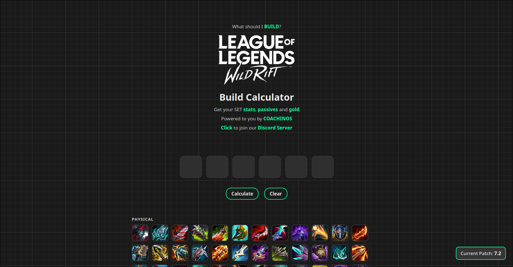
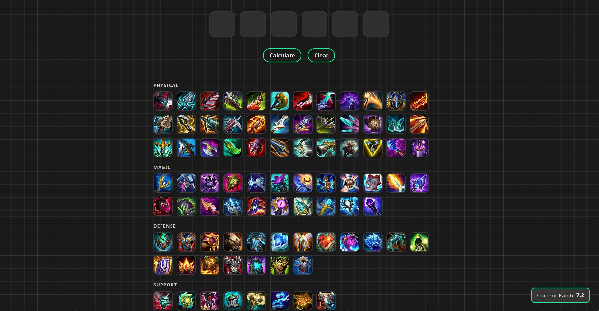
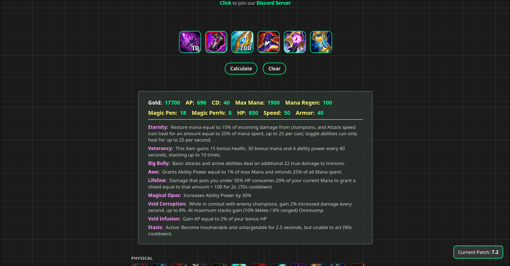
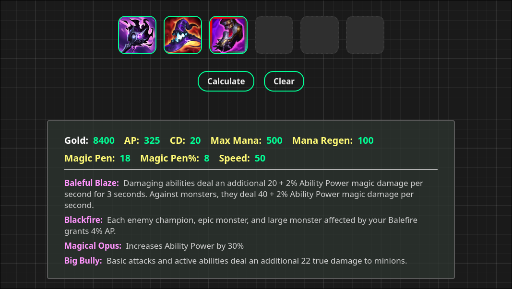
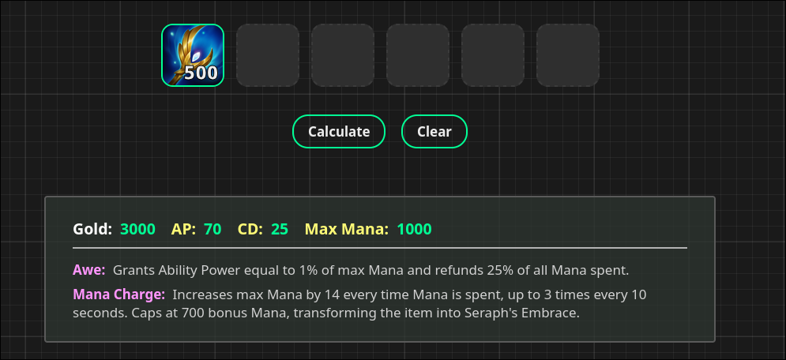
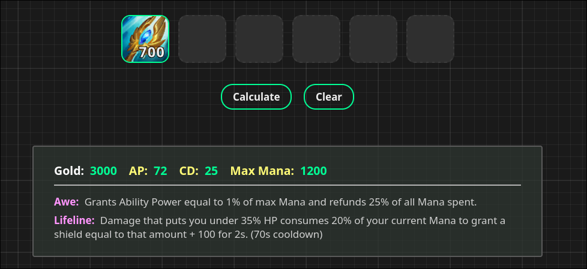
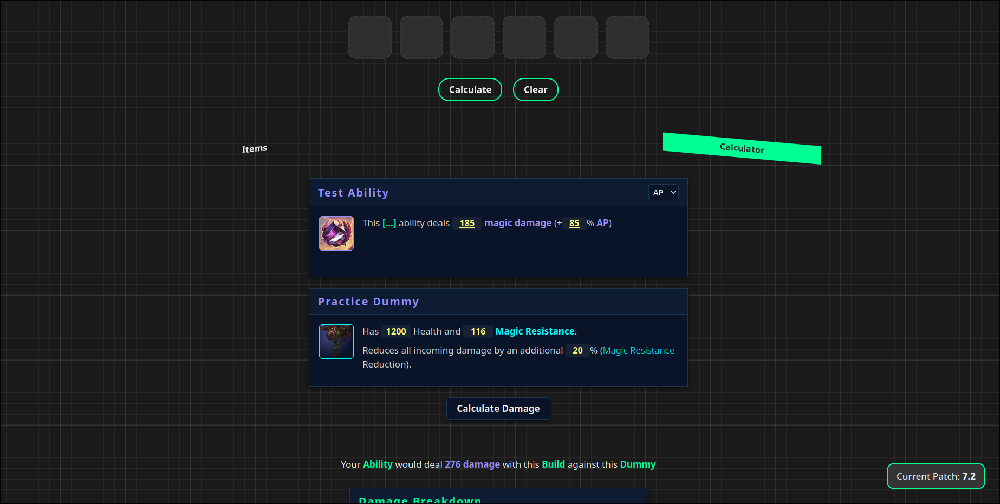
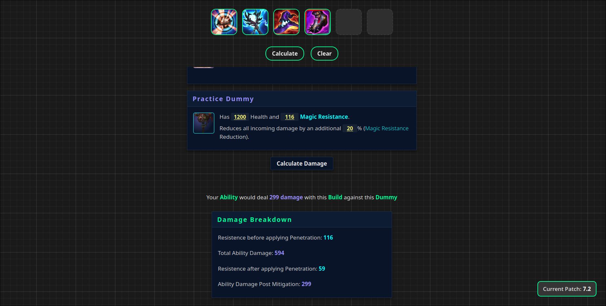

# Wild Rift Build Calculator

A web tool for **League of Legends: Wild Rift** that answers the question *"What should I build?"*.
Pick up to six items and get the total **stats**, **passives** and **gold** of the build, then test it
against a practice dummy to see how much damage an ability actually deals after penetration and resistances.

The backend is a small C++17 HTTP server that does the math; the frontend is plain HTML/CSS/JS.

Powered by **COACHINOS**. Join the [Discord server](https://discord.gg/WASb7cdtUF).

> Current patch: **7.3b**



---

## Features

### Item builder
- Item gallery grouped by category: **Physical, Magic, Defense, Support, Boots, Active**.

  

- Six build slots, with hover tooltips that show each item's stats and passives.
- Build rules enforced on both the client and the server:
  - at most **one Active** item and **one pair of Boots**;
  - items that share a unique tag (`bannedSet`, e.g. `MANAFLOW`, lethality items) can't be stacked;
  - at most 6 items.
- **Calculate** returns the combined stats of the build, its passives and its total gold cost.
- Handles the tricky stats:
  - **Adaptive Force**: each source uses its own AD ratio and converts to AP or AD depending on which one is higher;
  - **% penetration** from multiple sources stacks cumulatively;
  - stat conversions such as Mana → AD/AP/HP, HP → AP/AD and Mana → Heal & Shield Power;
  - **stackable items** (e.g. Mana charge items) with a charge input per slot.

A full 6-item build, with stacks on two of the items:



#### Passives that change stats
Passive stats are included in the totals. For example, *Magical Opus* adds 30% AP on top of the rest of the build:



#### Stacking items
Stackable items have a number field on their slot where you type the charge count. Stats scale with the charge count, and Mana charge items
**transform** into their upgraded version (with its new passive) once they hit the cap:

| Charging (500 / 700) | Transformed (700 / 700) |
|---|---|
|  |  |

The same applies to items with health stacks:


### Damage calculator
Simulates one ability hitting a practice dummy, using the stats from the last time you pressed **Calculate** on the build.

| Ability | Dummy |
|---|---|
| Damage type (AP / AD) | Health |
| Base damage | Resistance (Armor or Magic Resist) |
| Scaling ratio (% AP / % AD) | Extra incoming damage reduction % (e.g. *Force of Nature*) |

It returns the damage before mitigation, the resistance before and after penetration, and the final damage:

```
DMG    = base + stat × scaling / 100
R'     = R × (1 − %pen / 100) − flatPen
DMG'   = DMG / (1 + R' / 100)
DMG''  = DMG' × (1 − reduction / 100)
```

It's meant as a quick estimate (for example, *is it better to build penetration or raw damage here?*), not a full combat simulator.



**Example: raw AP vs. % penetration.** Same ability, same dummy (116 MR, 20% reduction), only the third item changes:

| Raw AP item | % Magic Pen item |
|---|---|
|  |  |
| 594 damage before mitigation, MR 116 → 59 | 470 damage before mitigation, MR 116 → 16 |
| **299** final damage | **324** final damage |

Against this target, the penetration item deals more damage even though the raw AP item has the higher number before mitigation.

---

## Getting started

The server listens on port **8080** by default; set the `PORT` environment variable to change it.
It serves `./public`, so run it from the repository root.

### Make
```bash
make        # builds ./wr_calc
make run    # builds and runs
```

### CMake
```bash
cmake -B build
cmake --build build
./build/wr_calc
```

### Docker
```bash
docker compose up --build
```
`public/` is mounted as a volume, so changes to the frontend and item data show up without rebuilding the image.

Then open <http://localhost:8080>.

**Requirements:** a C++17 compiler (g++ or clang) and pthreads. The only dependencies,
[cpp-httplib](https://github.com/yhirose/cpp-httplib) and [nlohmann/json](https://github.com/nlohmann/json),
are vendored as single headers in `src/third_party/`.

---

## Project structure

```
.
├── src/                    # C++ backend
│   ├── main.cpp            # HTTP server, routes and JSON → model parsing
│   ├── league.hpp/.cpp     # Stat, Passive, Object, Set, Ability, Dummy + game math
│   ├── token.hpp           # Numeric IDs for every stat type
│   └── third_party/        # httplib.h, json.hpp
├── readme/                 # Screenshots used in this README
├── public/                 # Frontend (served as-is)
│   ├── index.html
│   ├── css/style.css
│   ├── img/            # Item art and icons
│   └── js/
│       ├── statTypes.js    # Mirror of token.hpp (keep them in sync!)
│       ├── items.js        # Builds the ITEMS catalog from the category files
│       ├── items/          # physical.js, magic.js, defense.js, support.js, active.js, boots.js
│       ├── ui.js           # Rendering of slots, gallery, tooltips and results
│       ├── ability.js      # Damage calculator view
│       └── app.js          # State, build rules and API calls
├── Makefile
├── CMakeLists.txt
├── Dockerfile
└── docker-compose.yml
```

---

## API

Both endpoints take and return JSON. Stat `type` values are the numeric IDs from `token.hpp`.
On invalid input the server responds `400` with `{ "error": "..." }`.

### `POST /api/attributes`
Computes the total stats of a build.

```json
{
  "objects": [
    {
      "title": "Infinity Edge",
      "type": 30,
      "gold": 3500,
      "banned_set": [0],
      "stats": [{ "type": 12, "value": 75 }, { "type": 15, "value": 25 }],
      "passives": [{ "title": "Infinity", "desc": "..." }]
    }
  ]
}
```

### `POST /api/ability`
Computes the damage of an ability against the dummy.

```json
{
  "ability": { "type": 1, "base": 185, "scaling": 85 },
  "dummy":   { "HP": { "type": 7, "value": 1200 }, "R": { "type": 17, "value": 116 }, "reduction": 20 },
  "build":   [{ "type": 1, "value": 300 }, { "type": 5, "value": 15 }]
}
```

Response:

```json
{
  "PRE_MITIGATION_DAMAGE": 440,
  "RESISTANCE_BEFORE_PEN": 116,
  "POST_MITIGATION_DAMAGE": 175.12,
  "RESISTANCE_AFTER_PEN": 101
}
```

---

## Adding or updating items

Items live in `public/js/items/<category>.js`. Each entry looks like this:

```js
{
  title: "Kraken Slayer",
  category: "PHYSICAL",
  gold: 2900,
  image: "img/Kraken_Slayer_item_HD.png",
  stats: { AD: 45, ATTACK_SPEED: 35 },
  passives: [
    // A passive can carry stats of its own, which count toward the build total
    { title: "Cloud Stride", desc: "+4% Movement Speed", stats: { SPEED_PERCENTAGE: 4 } },
    { title: "Bring It Down", desc: "Every third attack deals ..." },
  ],
  // Optional:
  // bannedSet: ["MANAFLOW"],                       // unique tag, only one item per tag
  // stack: { stats: { MAX_MANA: 1 }, min: "0", max: "700", ... }  // stackable item
}
```

- Stat keys must exist in `public/js/statTypes.js`.
- To add a **new stat type**, add it to **both** `token.hpp` and `statTypes.js` with the same number,
  then handle it in `lol::Set::print()` in `league.cpp`.
- Put the item image in `public/img/`.
- After a balance patch, update the patch label in `public/index.html`.

---

## Author

Made by [JxViii](https://github.com/JxViii).

*Wild Rift Build Calculator isn't endorsed by Riot Games and doesn't reflect the views or opinions of Riot Games or anyone officially involved in producing or managing Riot Games properties. League of Legends: Wild Rift and Riot Games are trademarks or registered trademarks of Riot Games, Inc.*
